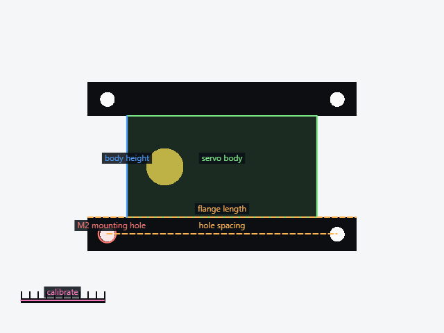
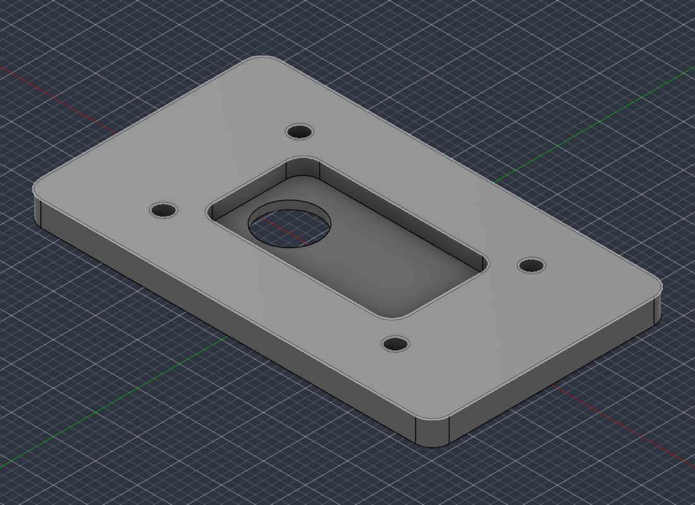

# Fusion2Hermes

**Point your Hermes agent at Fusion 360 and it builds the part.**

Fusion2Hermes connects [Autodesk Fusion 360](https://www.autodesk.com/products/fusion-360) to
[Hermes Agent](https://github.com/NousResearch/hermes-agent) over MCP, so the agent creates real
parametric features — sketches, extrudes, fillets, holes, patterns, assemblies, CAM toolpaths —
inside your running Fusion session, while you watch the feature tree grow.

It works on the **free personal-use licence**. That's the whole point: Autodesk's own MCP server
is gated behind a commercial subscription, but Fusion's Python scripting API isn't. Fusion2Hermes
exposes that API over a loopback MCP bridge, so no subscription, no cloud, no account linking.

```
you:  "40x30x10 mm plate, 4 mm corner fillets, four M3 clearance holes, export STL"
agent: ← builds it in Fusion, verifies the volume, hands you the STL
```

## Install

The intended path is: hand the repo URL to your Hermes and ask it to set this up.

> Set up https://github.com/Nilabh-code/Fusion2Hermes as a skill and install it.

The agent will clone it, run the installer, and tell you to restart Fusion once. Or do it yourself:

```bash
git clone https://github.com/Nilabh-code/Fusion2Hermes ~/Fusion2Hermes
python ~/Fusion2Hermes/scripts/setup.py
```

Then restart Fusion. Verify:

```bash
python ~/Fusion2Hermes/scripts/setup.py --check
```

Expected last lines:

```
[ok] add-in socket listening on 127.0.0.1:9876
[ok] live handshake OK - Fusion is ready for modelling
```

In Hermes, run `/reload-mcp` (or start a new session) to load the `mcp_fusion360_*` tools.

### Requirements

- Fusion **desktop**, installed and signed in at least once (Windows or macOS)
- `git` + `uv` recommended; a tarball download and plain `venv` are used if they're missing
- Hermes on `PATH`
- Python 3.10+ for the installer

The installer is idempotent — re-run it to repair or upgrade.

## How it works

```
Hermes ──stdio MCP──> fusion360_mcp (server) ──TCP, JSON lines──> Fusion360MCP add-in
                          Python venv                               inside Fusion
```

The add-in holds a socket on `127.0.0.1:9876` and marshals every call onto Fusion's main thread
through a `CustomEvent`. 93 commands are exposed; see
[`references/tools.md`](references/tools.md) for all of them with real signatures.

## What it can and can't do

| | |
|---|---|
| **Solid** | sketches + constraints, extrude, revolve, sweep, loft, fillet, chamfer, shell, holes + threads, mirror, patterns, booleans, construction geometry, components and joints, sheet metal with flat patterns, surface tools, measurement and interference, STL/STEP/F3D export, CAM setups → toolpaths → G-code |
| **Escape hatch** | `execute_code` runs arbitrary Fusion Python API code in the live document |
| **No** | Form / T-Spline sculpting, mesh → B-Rep conversion, 2D drawings, generative design, photoreal rendering |

Personal-use licence limits (Autodesk's, not ours): 10 editable documents, no extensions,
IGES/SAT export blocked. STEP/STL/F3D export all work.

## Beyond tool calls: photo → verified part

Telling an agent to "build a servo mount" and letting it loose on 93 tool calls is
how you get something that looks right and doesn't fit. The repo also ships
**`cadbridge`**, a second MCP server for the case where the input is a photo and a
sentence:

```
photo ──▶ canvas ──▶ millimetres ──▶ knowledge ──▶ build123d script
                                                       │
                     ┌─────────────────────────────────┘
                     ▼
             cad_run_code ──▶ measured volume / bbox / solids
                     │              │
                     │        mismatch → repair, up to 3×
                     ▼
                  STEP ──▶ fusion_push_step ──▶ your Fusion session
```

| | |
|---|---|
|  |  |
| *Trace the part, mark holes, calibrate one line — every shape comes back in mm* | *The same part, measured inside Fusion: 48.62 × 28.42 × 3.02 mm* |

- **Knowledge base** — 299 chunks: build123d's real signatures (extracted from the
  installed package), 13 executable recipes, ISO 273 / bearing / servo tables, FDM
  rules, Fusion API pitfalls. BM25 out of the box, hybrid dense if `fastembed` is
  present. `references/knowledge.md`.
- **Canvas** — import an image, trace edges, mark hole centres, draw dimension
  lines, calibrate one line to a known length. Returns millimetres plus a composite
  PNG for vision models. `references/canvas.md`.
- **Verified runner** — executes the generated script in a subprocess and reports
  the *measured* volume, bounding box, solid count and validity. Refuses anything
  that isn't exactly one valid solid. Then exports STEP/STL.
- **Fusion hand-off** — the STEP lands in the live document as a new component,
  which is what finally proves it.

Nothing reaches Fusion until it has been measured. The runner is a guardrail, not a
sandbox — read the [pitfalls](SKILL.md#pitfalls) before running model-generated code.

Any model can drive it: `cadbridge agent --base-url http://127.0.0.1:8080/v1` talks
OpenAI-compatible HTTP, so llama.cpp, LM Studio, vLLM, Ollama or a cloud API all work
through the same retrieve → generate → run → repair → push loop.

## Security

The socket is **loopback-only and unauthenticated**. Anything running on your machine can drive
Fusion while it's open — that's inherent to the design and true of every Fusion MCP bridge. Nothing
is uploaded anywhere; there is no telemetry. The add-in is third-party code executing inside your
CAD session: read it before you run it (link below), and don't install this on a shared machine.

## Credits

- [faust-machines/fusion360-mcp-server](https://github.com/faust-machines/fusion360-mcp-server) —
  the add-in and MCP server (MIT, pinned to `19b9f1e`). This repo is the installer, the skill, and
  a fix for STEP export on Fusion 2705.
- Autodesk Fusion's Python API.

See [NOTICE.md](NOTICE.md). Everything here is MIT.
